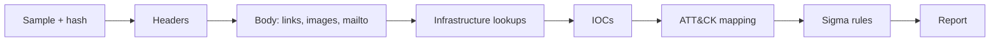

# Phishing Email Analysis

I'm building toward a SOC and detection engineering role, and this repo is where I practice on real phishing emails. Each case starts with a raw email from a public corpus and ends with a written report, a list of indicators, an ATT&CK mapping and a couple of Sigma rules.

I kept my mistakes in. If you only read one file besides the report, read [docs/lessons-learned.md](docs/lessons-learned.md).

## Cases

| Case | What it is | Techniques |
|---|---|---|
| [001](cases/case-001-reply-phishing) | A fake Microsoft sign-in alert with no login page. The buttons open an email to the attacker's Gmail address | T1583.001, T1585.002, T1684.001, T1598 |

## The order I work in



## What's here

```
docs/        method, lab setup, lessons learned
templates/   intake sheet, IOC CSV, report skeleton
tools/       newcase.sh, defang.py, verify-hashes.sh
cases/       one folder per case
SHA256SUMS   hashes of the published files
```

## Using the tools

```bash
sh tools/newcase.sh case-002-short-name
echo 'http://bad.example user@bad.example' | python3 tools/defang.py
sh tools/verify-hashes.sh
```

## Rules I follow

1. Everything runs in a VM on NAT, with snapshots and no shared folders.
2. I read samples as text. I never open them or click anything in them.
3. Indicators are defanged in notes and reports.
4. I only use public samples or my own mail.
5. I check every ATT&CK ID on attack.mitre.org for the version I cite.
6. I keep what I observed, what I concluded and what I assumed apart.

## What I leave out

Raw samples, header dumps, raw WHOIS output and live URL lists stay out of the repo, and `.gitignore` enforces that. Reports have no personal names, local paths or sandbox links. Indicators are defanged everywhere except the detection rule files, where a defanged value would never match.

## Limits

I've only checked the Sigma rules for syntax. None has run against real mail logs. The Case 001 domains are dead, so I couldn't get registration dates. I couldn't use PhishTank for Case 001.

## License

MIT, see [LICENSE](LICENSE).
