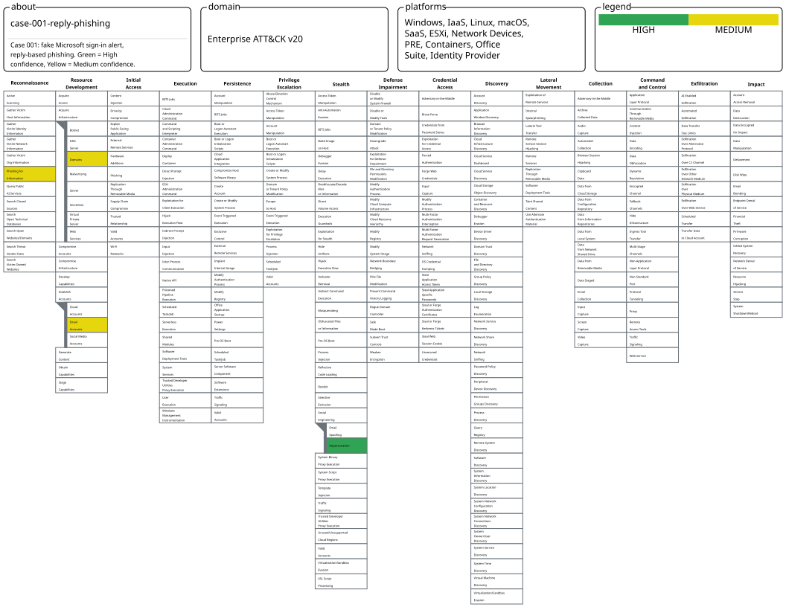

# Case 001: a phishing email with no link

Status: final. TLP: CLEAR. ATT&CK version: v20.

## 1. Executive summary

This is phishing, and a low-effort kind. The email poses as a Microsoft alert about unusual sign-in activity, but it never sends the reader to a login page. Both buttons are `mailto:` links that open a reply to a Gmail address. The attacker wants the victim to make the first contact.

Three facts back this up. The display name says Microsoft, but the sending domain is `access-accsecurity[.]com`. The Reply-To and both buttons point at one Gmail mailbox. And the body hides filler text to get past mail filters.

What I'd do: block the sender domain and the reply mailbox, search mail logs for both, and remind users that a real Microsoft alert will not ask them to email a Gmail address.

## 2. Scope and method

I analysed one public sample, `sample-1001.eml`, in an isolated Kali VM on NAT with shared folders off. I read the file as text and never visited any of the infrastructure in it. The steps are in [docs/methodology.md](../../../docs/methodology.md).

## 3. Email overview

| Field | Value |
|---|---|
| Subject | Microsoft account unusual signin activity |
| Display name | Microsoft account team |
| From | no-reply[@]access-accsecurity[.]com |
| Return-Path | bounce[@]nonkfrgr[.]co[.]uk |
| Reply-To | solutionteamrecognizd02[@]gmail[.]com |
| Date | 2023-07-27 |
| First-hop IP | 89[.]144[.]9[.]87 |

## 4. Technical findings

What I observed:
- From, Return-Path and Reply-To use three different domains, and none belongs to Microsoft.
- The HTML has two anchor tags, and both are `mailto:` links to the Gmail address.
- It also has one hidden 1x1 image served from `thebandalisty[.]com`. That is a tracking pixel, and it tells the sender when the mail is opened.
- A style block holds hidden filler text, a common way to dilute spam filters.
- SPF returned `none`.

What I concluded:
- The attacker most likely wants to start an email conversation and ask for credentials or payment details there.
- SPF `none` means the domain publishes no policy. That is weaker than `fail`, so I don't treat it as proof on its own.

What I assumed:
- The Gmail account was probably created for this, but it could be a compromised account. I can't tell which.

There is no redirect chain to trace, because the message has no web link, only a pixel and two mailto buttons.

Read as a person would see it, the message is a short warning about a sign-in from an unusual location, followed by two buttons telling the reader to contact the account team.

Screenshots: [headers](../evidence/screenshots/07-headers-key-fields.png), [Received chain](../evidence/screenshots/08-headers-received-chain.png), [pixel search](../evidence/screenshots/09-body-anchor-and-pixel-search.png), [mailto buttons](../evidence/screenshots/10-body-mailto-anchors-and-dig.png), [readable message](../evidence/screenshots/11-body-readable-message.png).

## 5. Infrastructure

| Indicator | Lookup | Result |
|---|---|---|
| access-accsecurity[.]com | WHOIS, DNS | Not registered today. Creation date unknown |
| nonkfrgr[.]co[.]uk | WHOIS, DNS | Not registered today. Creation date unknown |
| thebandalisty[.]com | WHOIS, DNS | Not registered today. Creation date unknown |
| 89[.]144[.]9[.]87 | WHOIS | Block record dated 2025, so today's owner may differ from the 2023 one |

A VirusTotal URL report for `hxxp://thebandalisty[.]com/` (scan dated 2026-09-24 10:57 UTC) showed 10 of 91 vendors flagging it. Eight called it phishing and two (Chong Lua Dao and Webroot) called it malicious, and ESET marked it suspicious. VirusTotal categorised the domain as phishing and parked. The OpenPhish community feed (300 lines, downloaded after following a redirect) had no matches. I couldn't use PhishTank, so I didn't check it. All of these describe the domains today, not what they served in 2023.

Screenshots: WHOIS for [the From domain](../evidence/screenshots/12-whois-access-accsecurity.png), [the IP](../evidence/screenshots/13-whois-ip-block.png) and [the pixel domain](../evidence/screenshots/14-whois-dig-thebandalisty.png); VirusTotal [summary](../evidence/screenshots/15-virustotal-summary.png) and [vendors](../evidence/screenshots/16-virustotal-detection.png); [sandbox DNS](../evidence/screenshots/18-sandbox-dns-requests.png); [OpenPhish feed](../evidence/screenshots/20-openphish-300-line-feed.png).

## 6. IOC appendix

The indicators are in [iocs/iocs.csv](../iocs/iocs.csv). High confidence means I saw the value directly in the file. Medium means I inferred it or the record is dated.

## 7. ATT&CK mapping

| Tactic | Technique | Evidence | Confidence |
|---|---|---|---|
| Resource Development | T1583.001 Acquire Infrastructure: Domains | Three throwaway domains | Medium |
| Resource Development | T1585.002 Establish Accounts: Email Accounts | Gmail reply mailbox | Medium |
| Stealth | T1684.001 Social Engineering: Impersonation | Fake Microsoft display name and alert | High |
| Reconnaissance | T1598 Phishing for Information | Buttons push the reader to email the attacker | Medium |

I looked at T1684.002 (Email Spoofing) and dropped it, since the From domain belongs to the attacker. I also dropped T1566.001, T1566.002, T1204 and the credential-capture techniques, because the email has no attachment, no web link and no fake login page. The reasoning is in [attack/mapping.md](../attack/mapping.md). The Navigator layer is [attack/layer.svg](../attack/layer.svg) (data in [layer.json](../attack/layer.json)), and the checks on attack.mitre.org are in [evidence/](../evidence/README.md).

## 8. Detection and response

Two Sigma rules cover the sender domain plus Reply-To mailbox (`detections/sigma-email-case001.yml`) and DNS lookups for the pixel domain (`detections/sigma-dns-case001.yml`). Both pass `sigma check` and convert to Lucene with the ECS pipeline ([check](../evidence/screenshots/27-sigma-check-pass.png), [convert](../evidence/screenshots/29-sigma-ecs-pipeline-and-convert.png)). That shows they are well formed. It doesn't show that your logs carry those fields.

`detections/behavior-ideas.md` has rules that would survive a change of domain. I haven't tested them.

## 9. Confidence and limitations

- The domains no longer resolve, so I don't know when they were created.
- The IP block record dates from 2025, two years after the email.
- I never ran the rules against real mail logs.
- Early on, a VM freeze emptied my working copy of the sample. I re-copied it from the source and confirmed the hash matched. The story is in [docs/lessons-learned.md](../../../docs/lessons-learned.md).
- I didn't check PhishTank.

## 10. Timeline

| Date | Event |
|---|---|
| 2023-07-27 | Email sent, per the Date header |
| 2026-10 | I analysed it and wrote this report |

## 11. Evidence index

| File | SHA256 | Published |
|---|---|---|
| sample-1001.eml | a28a794537f537758b69ba34835090f5ee0e76380bff07101811ab85a3fd84cf | No, it is public in the source corpus |
| Raw header dump | n/a | No |
| Raw WHOIS output | n/a | No |
| 30 lab screenshots | see SHA256SUMS | Yes, in [evidence/](../evidence/README.md) |
| Everything else in this repo | see SHA256SUMS | Yes |
